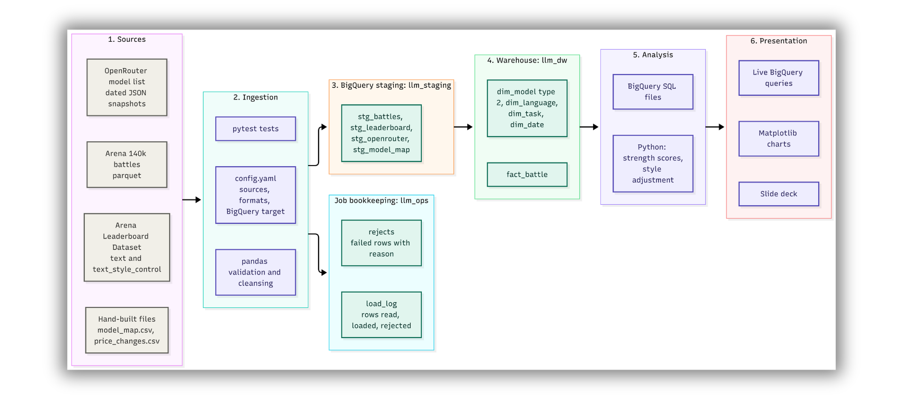
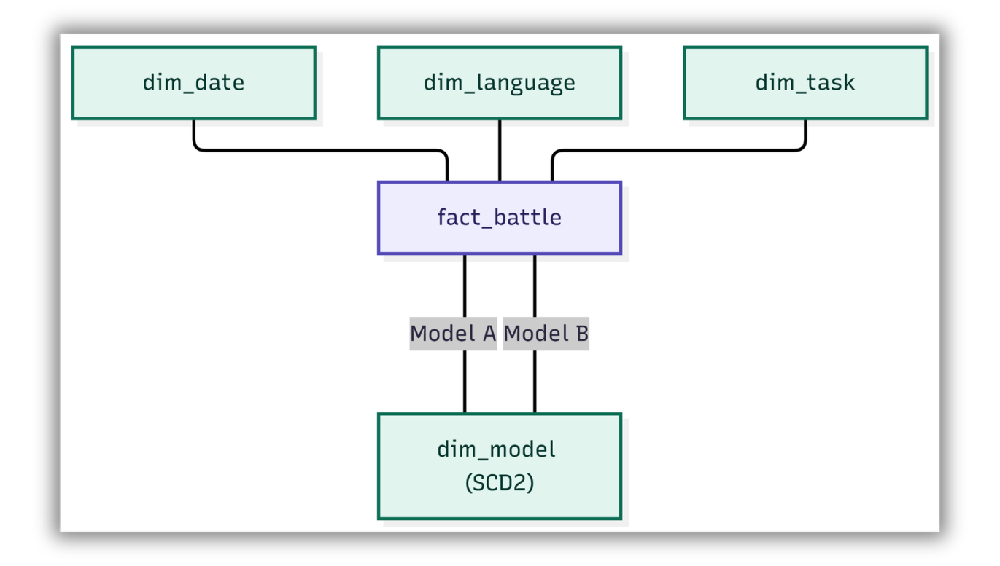

# Arena to Boardroom: The LLM Value Frontier

**Project 0** | Data warehouse and analytics for an enterprise AI buyer

**Authors:** Astha Patel, Kiranjot Assi
**Repository:** [github.com/2494-Gen-AI-CN/KiranjotAssi (branch ATB_Kiranjot, Rev-Project-0)](https://github.com/2494-Gen-AI-CN/KiranjotAssi/tree/ATB_Kiranjot/Rev-Project-0)

---

## 1. Business case

### Short explanation

Cognizant is evaluating language models for enterprise chat. The team needs a shortlist that balances user preference, workload fit, and cost. We built a BigQuery warehouse from Arena preference votes and related model and pricing data, then analyzed model strength across releases, languages, prompt lengths, and price points. The results support a shortlist for further testing; they do not identify one model that is best for every task.


### Business Question

1. How did the preference-strength gap between open-weight and closed models differ across the 2024 and 2025 Arena releases?  
2. How did relative model strength vary across languages and prompt lengths?  
3. Was price associated with Arena strength among models with matched price and vote data?  
4. Which models offered a strong preference score at a lower price in our sample?  
5. How would a price change affect the shortlist under a modeled scenario?

## 2. Headline findings

 - The estimated open-versus-closed gap was about 39.5 Elo-like points in the 2024 release and 48.0 points in the 2025 release. The gap was 8.5 points wider in the 2025 sample; two releases do not establish a continuous trend.  
- In the 2025 English prompt-length analysis, o3 was about 22 points above its overall strength in Q2 and 30 points below it for the longest prompts. Each displayed model had at least 200 battles in each bucket. This describes a pattern in the Arena votes, not a cause.  
 - In the 2024 language comparison, Llama 3 70B was roughly 69 points above its overall strength in English and 95 points below in Chinese. This is relative to that model’s overall strength in the sample, not a universal measure of language ability.  
- Across 34 matched models, blended price and Arena strength had a Pearson correlation of about 0.02, indicating almost no linear association in that sample.  
- A separate price-preference frontier analysis found 7 of 51 eligible models on the frontier. The 34-model correlation sample and 51-model frontier sample are different analyses.

## 3. Data sources

| ID | Dataset | Link |
|----|---------|------|
| D1 | Arena human preference 140k | [arena-human-preference-140k](https://huggingface.co/datasets/lmarena-ai/arena-human-preference-140k) |
| D2 | Arena human preference 100k | [arena-human-preference-100k](https://huggingface.co/datasets/lmarena-ai/arena-human-preference-100k) |
| D3 | OpenRouter model list | [openrouter.ai/api/v1/models](https://openrouter.ai/api/v1/models) |
| D4 | Hugging Face Hub API reference | [hf_api](https://huggingface.co/docs/huggingface_hub/package_reference/hf_api) |
| D5 | Arena Leaderboard Dataset | [leaderboard-dataset](https://huggingface.co/datasets/lmarena-ai/leaderboard-dataset) |

---

## 5. Repository layout

```text
Rev-Project-0/
  ATB_a/
    config.yaml
    requirements.txt
    .gitignore
    data/
      raw/
        arena-140k/data/*.parquet
        leaderboard/text_full.jsonl
        leaderboard/text_style_control_full.jsonl
      processed/
        arena_battles.jsonl
        openrouter_prices_2026-11-08.csv
        Manual_prices.jsonl
    ingest/
      create_export.py
      ingest_arena.py
      ingest_openrouter.py
      ingest_leaderboard.py
      ingest_manual_prices.py
    warehouse/
      dim_date.sql
      dim_language.sql
      dim_task.sql
      dim_model.sql
      fact_preference_battle.sql
    analysis/
      quality_per_dollar.sql
      model_vs_context.sql
      price_cut.sql
      quality_per_dollar_plot.py
      model_vs_context_plot.py
      price_cut_plot.py
      results/
      charts/
  ATB_k/
```

---

## 6. Installation

### 6.1 Installation (ATB_a)

#### Prerequisites

- Install Python, Git, and Google Cloud CLI. The project was developed with Python 3.15 and a local virtual environment. A fresh 3.15 dependency installation has not been independently retested for this document.
- Use a Google Cloud project with BigQuery enabled and permission to create datasets, load tables, and run queries.
- BigQuery sandbox can support a learning workflow subject to its limits and table-expiration behavior. Check project settings before treating it as permanent storage. Existing CSV price ingestion does not require an OpenRouter key. See the [BigQuery sandbox documentation](https://cloud.google.com/bigquery/docs/sandbox).

#### 1. Clone and open the supplied project folder

```bash
git clone https://github.com/2494-Gen-AI-CN/KiranjotAssi.git
cd KiranjotAssi
git checkout ATB_Kiranjot
cd Rev-Project-0
```

If the cloned branch uses a different directory name, enter the directory containing `config.yaml` and `requirements.txt`.

#### 2. Create the virtual environment and install packages

```powershell
python -m venv .venv

# Windows PowerShell
.\.venv\Scripts\Activate.ps1

# macOS/Linux alternative
# source .venv/bin/activate

python -m pip install -r requirements.txt
```

After activation, use `python` consistently for all commands. This avoids installing a package into one interpreter and running the scripts with another.

#### 3. Authenticate

```bash
gcloud config set project YOUR_PROJECT_ID
gcloud auth application-default login
python -c "import google.auth; google.auth.default(); print('Ready')"
```

#### 4. Create datasets if they do not exist

```bash
bq --project_id=YOUR_PROJECT_ID --location=US mk --dataset llm_staging
bq --project_id=YOUR_PROJECT_ID --location=US mk --dataset llm_dw
bq --project_id=YOUR_PROJECT_ID --location=US mk --dataset llm_ops
```

Use the same location for all three. Update `project_id` and paths in `config.yaml` for ATB_a.

#### 5. Place the source files and export Arena

Download the sources listed in [section 3](#3-data-sources), place them at the configured paths, and retain the selected snapshots. Existing complete, up-to-date exports can be reused.

```bash
python ingest/create_export.py
```

#### 6. Validate before loading

```bash
python ingest/ingest_arena.py --dry-run
python ingest/ingest_openrouter.py --dry-run
python ingest/ingest_leaderboard.py --dry-run
python ingest/ingest_manual_prices.py --dry-run
```

Inspect accepted, rejected, and filtered counts. Resolve unintended validation failures before refreshing staging.

#### 7. Load staging

```bash
python ingest/ingest_arena.py
python ingest/ingest_openrouter.py
python ingest/ingest_leaderboard.py
python ingest/ingest_manual_prices.py
```

These are refresh commands. Inspect the configured destinations before running them against existing project data.

#### 8. Build the warehouse in BigQuery

Run `warehouse/dim_date.sql`, `dim_language.sql`, `dim_task.sql`, `dim_model.sql`, then `fact_preference_battle.sql`.

`dim_model.sql` initializes `stg_model_map` if absent. On first setup, apply verified model mappings and rerun `dim_model` before building the fact table. Preserve those mapping records for reproducibility.

### 6.2 Installation (ATB_k)
Run in this order: 
cd Rev-Project-0

# Git Bash
export GOOGLE_CLOUD_PROJECT="YOUR_PROJECT_ID"

python -m src.analysis.calculate_gap
python -m src.analysis.recalculate_language_gaps
python -m src.analysis.calculate_prompt_gaps
python -m src.visualizations.create_charts
## 7. Configuration

`config.yaml` names the BigQuery target and every raw source. Adding a source file is a configuration change, not a code change.

### Part A: config.yaml

```yaml
bigquery:
  project_id: "your-projectid"
  location: "US"
  staging_dataset: "llm_staging"
  warehouse_dataset: "llm_dw"
  operations_dataset: "llm_ops"

sources:
  - path: "data/arena_sample.jsonl"
    format: "json"
    staging_table: "stg_battles_test"

  - path: "data/processed/arena_battles.jsonl"
    format: "json"
    staging_table: "stg_battles"

  - path: "data/processed/openrouter_prices_2026-11-08.csv"
    format: "csv"
    staging_table: "stg_openrouter"

  - path: "data/raw/leaderboard/text_full.jsonl"
    format: "json"
    staging_table: "stg_leaderboard"
    leaderboard_variant: "text"

  - path: "data/raw/leaderboard/text_style_control_full.jsonl"
    format: "json"
    staging_table: "stg_leaderboard"
    leaderboard_variant: "text_style_control"

  - path: "data/processed/manual_prices.jsonl"
    format: "json"
    staging_table: "stg_manual_prices"
```

### Part B: Python settings

```python
import os

PROJECT_ID = os.environ["GOOGLE_CLOUD_PROJECT"]
DATASET_ID = "llm_arena"
```

---

## 8. Ingestion: validation, rejects and load log
The source paths, formats, and BigQuery staging destinations are listed in config.yaml. The Python ingestion jobs validate required fields and types, parse timestamps, apply the documented cleansing rules, and remove duplicates using [deduplication key].  

Valid records load into the configured staging tables. Rejected records are written to [exact rejects table] with a reason for rejection. Each run writes to [exact load-log table], recording the run time, source, rows read, rows loaded, and rows rejected. Dry-run mode validates the sources without loading them. Regular loads replace the configured staging tables the configured staging tables.

| Source | Duplicate key | Rejects table | Load-log table | Staging load behavior |
|---|---|---|---|---|
| Arena battles | `id` | `llm_ops.arena_rejects` | `llm_ops.arena_load_log` | Replaces staging data (`WRITE_TRUNCATE`) |
| OpenRouter snapshots | `(model_id, snapshot_date)` | `llm_ops.openrouter_rejects` | `llm_ops.openrouter_load_log` | Replaces staging data (`WRITE_TRUNCATE`) |
| Leaderboard | `(leaderboard_variant, category, leaderboard_publish_date, model_name)` | `llm_ops.leaderboard_rejects` | `llm_ops.leaderboard_load_log` | Replaces staging data (`WRITE_TRUNCATE`) |
| Manual prices | `arena_name` | `llm_ops.manual_prices_rejects` | `llm_ops.manual_prices_load_log` | Replaces staging data (`WRITE_TRUNCATE`) |


The load-log tables are:
- llm_ops.arena_load_log
- llm_ops.openrouter_load_log
- llm_ops.leaderboard_load_log
- llm_ops.manual_prices_load_log

## 9. Warehouse design

1. **Sources:** Arena battles, leaderboard history, OpenRouter snapshots and three hand-built files.
2. **Ingestion:** a config-driven Python job validates and cleans every record with pandas.
3. **Staging:** valid rows land in BigQuery as they arrived (dataset `llm_staging`). Failed rows go to the rejects table and every run writes a load log (dataset `llm_ops`).
4. **Warehouse:** a star schema is built from staging (dataset `llm_dw`).
5. **Analysis:** SQL files join the fact table to its dimensions. Python uses the exported results from the BigQuery SQL runs and presents them into respective charts.
6. **Presentation:** Matplotlib charts, the slide deck and queries run live in BigQuery.

**Figure 4.1:** ETL pipeline



**Figure 4.2:** STAR schema



### SCD Type 2

Model state changes are reconstructed from leaderboard and observed price events. Unchanged states are removed, keys are generated per model/start date, and validity ranges use inclusive `effective_from` and exclusive `effective_to`. A final sentinel end date marks `is_current=true`. A battle joins the model version valid on its date.

For DeepSeek, the version valid June 18 to before June 24, 2025 had rating 1411.00. A June 20 battle joins that version. The reported dimension contained approximately 5,994 versions for 53 current model identities; multiple versions are expected.

---

## 10. Analysis

### Engineered features

| Feature | Definition |
|---------|------------|
| Pareto flag | True when no eligible model is at least as strong and at most as expensive with a strict advantage on one measure. |
| Style rank shift | Controlled rank minus raw rank. |

Mean preference and scenario savings are additional derived measures.

### Correlation

The analysis examined the relationship between blended token price and Arena preference strength across 34 matched models. The Pearson correlation coefficient of r = 0.02 indicated almost no linear association between the two variables. Blended prices assumed an equal input/output token mix, and models were grouped relative to the sample's median price and strength. Models with higher strength and lower prices represented potential candidates for cost-effective adoption. This association does not establish causation, as model characteristics, provider pricing strategies, and differences in the observed battles may influence the results.

---

## 11. Charts and slides

The analysis charts are generated from BigQuery query results using Matplotlib. They show the open-versus-closed strength gap, language and prompt-length patterns, price versus strength, and the price-preference frontier. The slide deck presents the client questions, findings, limitations, and recommendation. During the presentation, the team runs selected SQL queries live in BigQuery.

## 12. Tests

### Checks performed

The ingestion scripts enforce required values, types, domains, duplicate keys, date parsing, and price/count ranges. Dry runs were used before loading. Observed load counts, source-prefixed logs/rejects, SQL row counts, mapping coverage, and SCD2 history queries supplied verification evidence.

---

## 13. Limitations

- Votes measure chat preference, not accuracy on enterprise tasks.
- The match between model names across sources is partly manual: 51 of 53 models matched.
- Style control reduces length and formatting effects. It does not remove every bias.

---

## 14. Licences and attribution

Arena data: Arena (LMArena), prompts under CC BY 4.0, model outputs under each provider's terms. Prices: OpenRouter.
